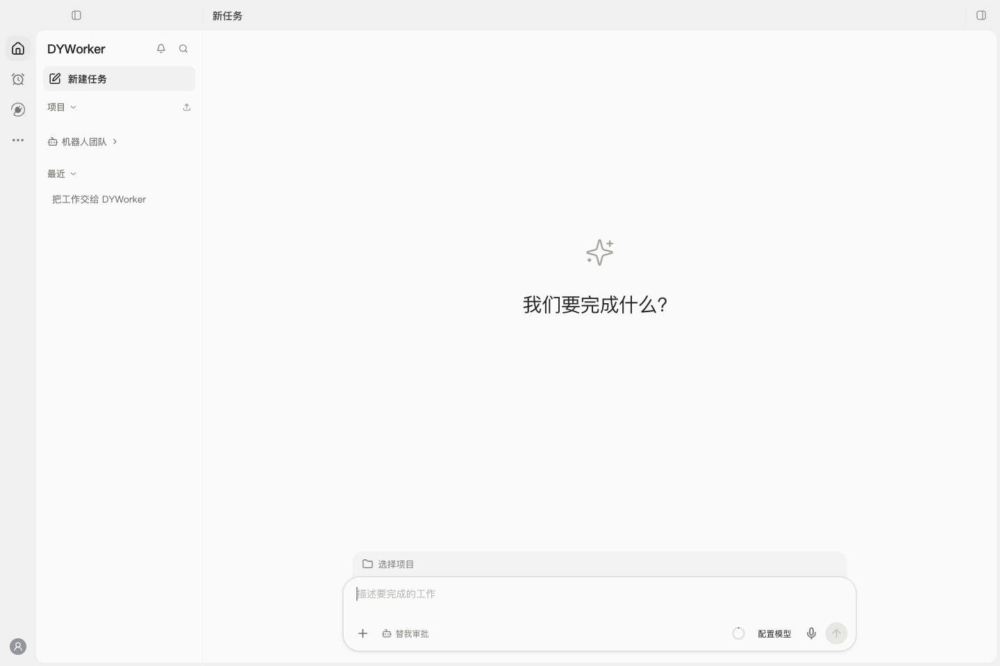
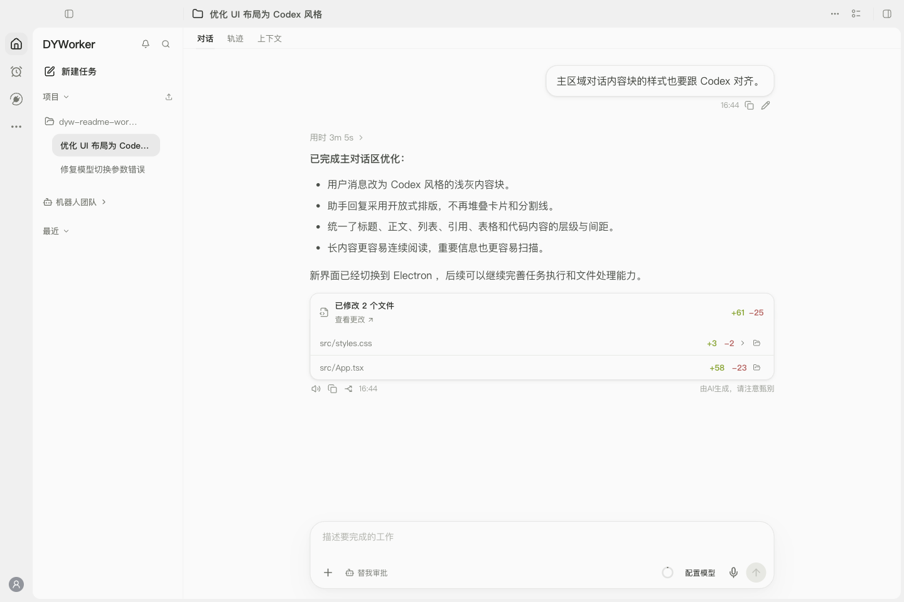
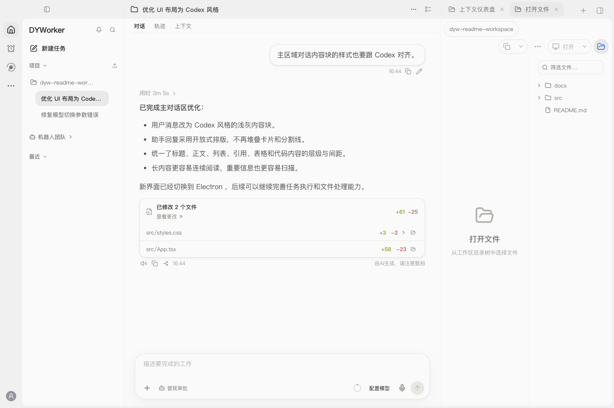
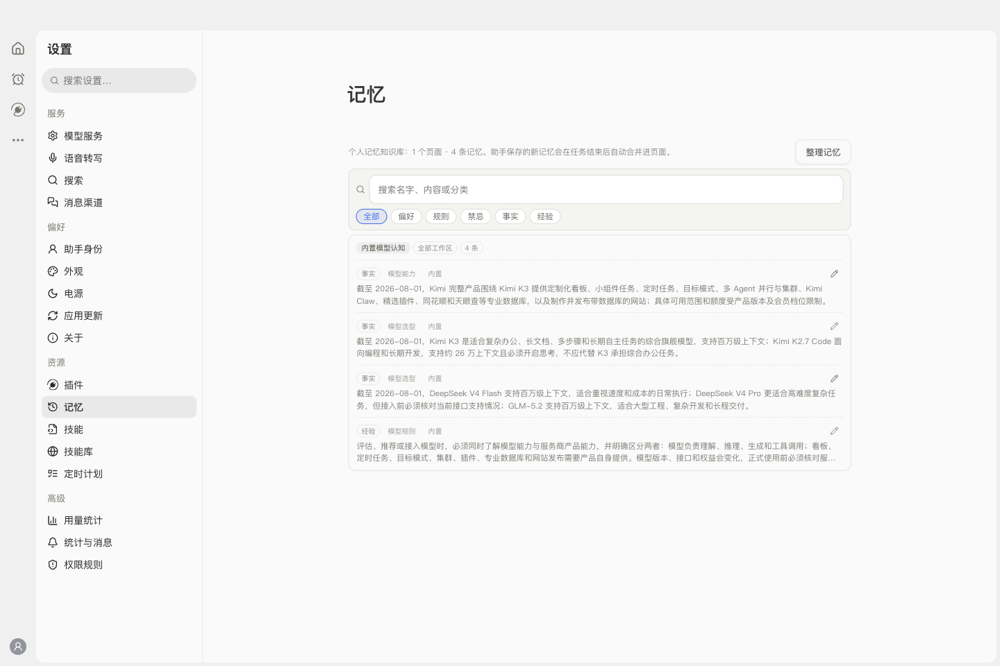
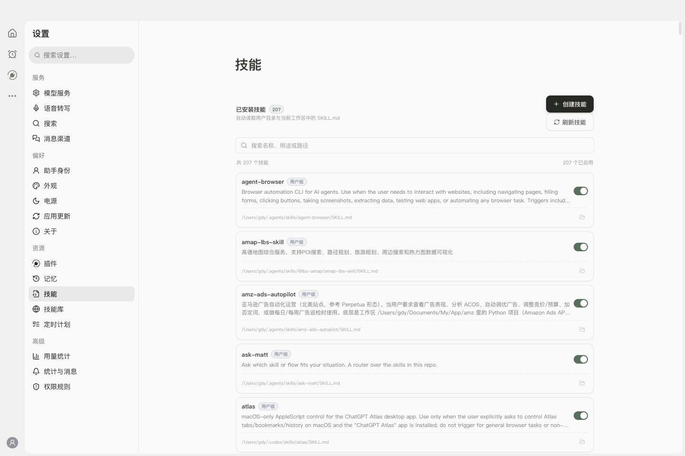
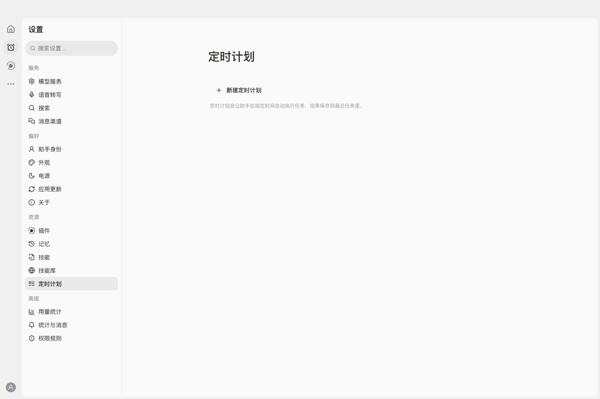
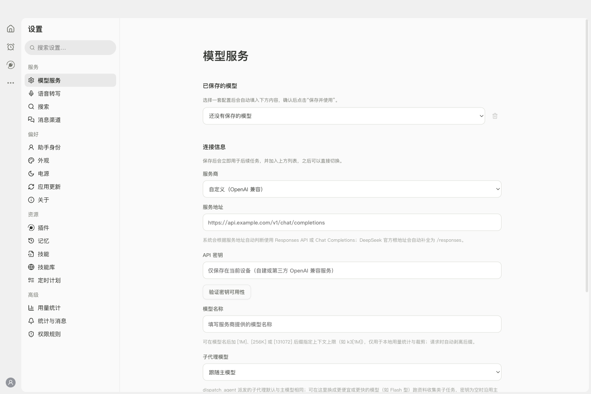
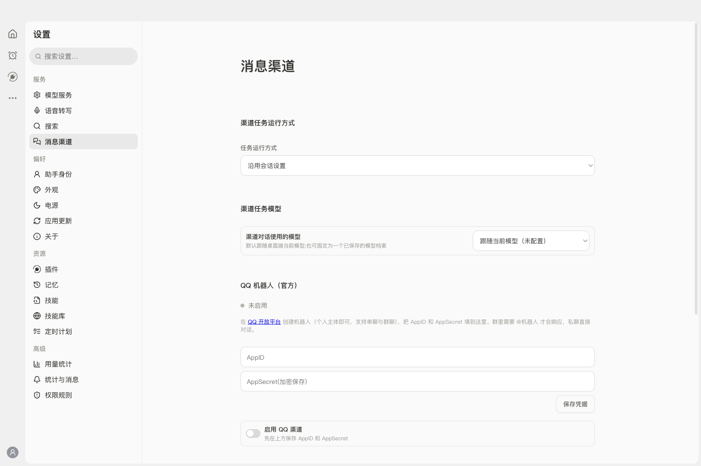
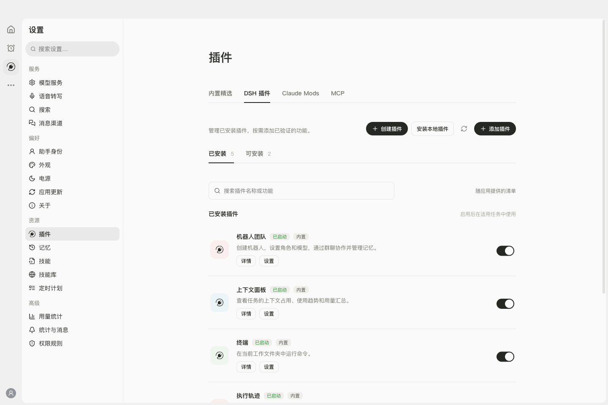
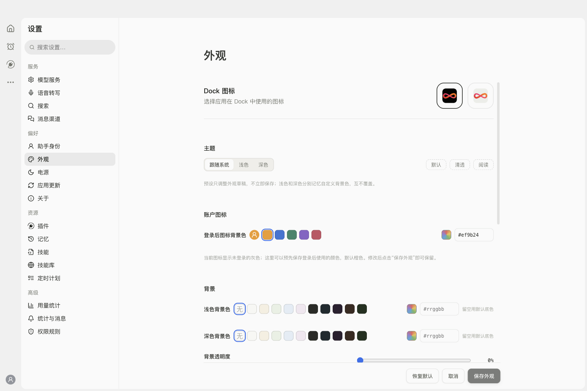

# DYWorker

DYWorker 是一款本地运行的 AI 工作助手。选择一个文件夹作为工作区，用自然语言描述目标，助手就会自己拆解步骤、逐步执行：读资料、理内容、写文档、做表格、操作办公软件，并在有风险的操作前先请求确认。你的任务资料、文件与配置默认全部保留在本机；模型对话会按你配置的模型服务地址发送给对应服务商（见下文「数据与隐私」）。

本仓库只保留当前 Electron + React + TypeScript 桌面版，不包含旧 Qt/C++ 版本、历史构建产物和在线原型托管代码。



> 下列截图来自当前版本的 macOS 桌面应用，使用独立的演示环境；对话内容采用项目自带示例，文件面板使用演示文件夹，不代表本次实际执行了示例任务。其他系统的窗口按钮和快捷键会有所不同。

## 新版界面导览

- **左侧导航**：进入首页、计划任务、插件和设置；侧栏按项目与最近对话整理任务，支持搜索和导入。
- **中间工作区**：点击“新建任务”，选择项目文件夹，再输入目标。已有任务可在“对话”“轨迹”“上下文”之间切换；后两项由内置插件提供。
- **输入框**：通过“添加内容”带入资料，选择审批方式，并在右下角配置或切换模型。
- **右侧工具栏**：从窗口右上角展开，按需打开文件、审阅、浏览器、侧边聊天和后台任务；终端由内置插件提供。
- **设置页面**：按服务、偏好、资源和高级分组，也可以直接搜索设置项。

## 核心能力

### 📁 以工作区为中心的任务对话

选择一个文件夹作为工作区，用自然语言描述目标。助手会自动拆解步骤、逐步执行；任务历史、执行过程和工作区文件随时可浏览、可追溯。



### 📄 办公全家桶读写与文件生成

文本、PDF、Word、Excel、PPT 都能读取；还能直接创建和导出 Word 文档、Excel 表格——不是给一段文本让你自己贴，而是把真实文件生成到工作区里。回答中还支持图表、步骤条等可视化展示，便于对比和决策。

展开右侧工具栏并选择“文件”，可以浏览工作区目录、筛选文件和打开预览；文件也可以直接引用到输入框。



### 🧠 长期记忆 + 工作模板 + Skills

告诉它一次"我们单位的公文格式要求"，它就记住了。记忆分为偏好、规则、禁忌、事实、经验五类，可以全局通用，也可以只属于某个工作区。常用任务还能沉淀为**工作模板**，下次一键复用；同时支持安装 Skills 技能包，扩展专项能力。





打开“设置 → 技能库”即可搜索和安装 SkillHub 技能。首次使用前，请按 [SkillHub 安装说明](https://skillhub.cn/install/skillhub.md) 安装 CLI；安装后的技能会自动出现在“技能”列表中。技能库按来源列表管理，后续可以继续接入其他来源。

### ⏰ 计划任务与自动续跑

从左侧“计划任务”或“设置 → 定时计划”进入计划管理，点击“新建定时计划”安排任务。长任务还支持定时唤醒（1 分钟到 12 小时）与中断后自动续跑。



### 🔌 开放模型接入

兼容常见的 **OpenAI Chat Completions 和 Responses API**，已内置 DeepSeek V4 Flash 和 V4 Pro，支持多套模型配置自由切换——DeepSeek、通义、智谱，或是单位内网自建的模型服务，填上地址和密钥就能用。密钥通过**系统安全存储加密保存**，绝不明文落盘。

DeepSeek V4 Flash 或 V4 Pro 选择后也可以处理图片：在模型设置中填写一个支持图片的 OpenAI 兼容视觉服务地址、模型名称和密钥。DYWorker 会先让视觉服务把图片转换成描述，再交给 DeepSeek 继续分析；原图不会直接发送给纯文字接口。



### 💬 QQ / 微信消息渠道

不在电脑前也能远程派活、收结果：支持接入 **QQ 官方机器人**和**微信 ClawBot**，手机上发消息即可。

打开“设置 → 消息渠道”，配置 QQ 机器人或微信 ClawBot，并选择渠道使用的模型和任务运行方式。



### 🖥️ 本机操作与国产化支持

- 可以操作 macOS、Linux 桌面上的应用：激活窗口、点击、输入文字，让 AI 从"动口"变成"动手"。
- 原生支持麒麟 V10（ARM64）和 UOS：一条命令打出 `.deb` 安装包，直接安装。
- 首次使用可一键"检查并安装本机操控环境"，缺什么组件自动补装（安装前请求系统授权）。
- 系统级能力通过 systemd-logind / freedesktop D-Bus 对接，麒麟/UOS 上尽力支持，不支持时静默降级，不会报错崩溃。

### 🔍 执行过程与文件审阅

- **执行轨迹**：在会话上方切换到“轨迹”，查看任务执行记录；“上下文”用于查看当前会话的上下文信息。需要启用对应内置插件。
- **文件更改**：回复中的“查看更改”可打开审阅，查看文件差异；审阅面板还支持暂存、放弃改动、提交和推送，破坏性操作会先请求确认。
- **文件工作台**：文件树行尾的引用按钮可把文件带进输入框；文本文件可在预览中编辑并保存，未保存草稿可跨会话和重启保留。
- **布局记忆**：右侧面板的标签页与宽度按会话保存，切换会话后恢复。

### 🧩 插件与外观设置

打开左侧“插件”或“设置 → 插件”，可查看“内置精选”“DSH 插件”“Claude Mods”“MCP”四类扩展。DSH 插件页可管理已安装与可安装插件，也可以安装本地插件；执行轨迹、上下文面板和终端等功能由内置插件提供。



打开“设置 → 外观”，可以选择跟随系统、浅色或深色主题，调整背景色、背景图片、透明度和字体。更改后可先预览，点击“保存外观”保留。



### 🛡️ 安全：全程可审计，关键操作必确认

- 风险命令和本机界面修改会先弹窗确认；
- 工作区外路径显示完整位置，单次操作单次授权；
- 文件、命令、联网、外部工具调用全部留痕；
- 密钥、登录凭据和任务数据只保存在本机用户数据目录。

## 数据与隐私

- **本地业务资料**：工作区文件、任务记录、记忆、技能和配置全部保存在本机，不上传云端。
- **模型请求**：执行任务时，对话内容会按你自己配置的模型服务地址发送给对应服务商；用本地模型则不出网。
- **使用统计与运营消息（可选，默认关闭）**：在「设置 → 统计与消息」中开启后，应用会向管理员配置的安全监管平台受控接口上传使用元数据——前台有效使用时长（只在窗口处于前台且近期有人工操作时计时）、日期、应用版本与平台，断网时先存本地（最多 7 天或 20MB）恢复后自动补传；不上传聊天内容、文件、提示词、模型地址与密钥，也不采集 MAC 地址、硬盘序列号、主机名和系统用户名。开启运营消息订阅后会接收公告、版本提醒与维护通知，未读消息在收件箱的「系统消息」页查看。两项功能可以分别开关；关闭统计会立即停止采集并清空待传队列，也可以随时在设置里删除此安装已上传的数据。政府或内网部署填写对应内部服务地址即可，留空表示完全不连接。

## 快速开始

**环境要求**：Node.js ≥ 22.18、npm 10+；支持 macOS、Windows 10/11、常见 Linux 桌面（含麒麟 V10）。

```bash
npm ci
npm run dev:electron
```

只启动网页界面预览（本机文件、插件和系统能力需要桌面应用）：

```bash
npm run dev
```

首次启动时先选择“通用身份”或“政府单位”，之后打开“设置 → 模型服务”，选择服务商并填写服务地址、模型名称和密钥，点击“保存并使用”。回到首页，点击“新建任务”并选择项目文件夹，就可以描述目标；使用 DeepSeek V4 Flash 或 V4 Pro 看图时，再按设置页提示补充视觉服务信息。身份可以在“设置 → 助手身份”中修改。

## 打包发布

首次打包前会自动构建并运行全部测试。重复打包时，如果源码、配置、测试、依赖和构建产物均未变化，会复用本机已通过的检查；文件变化或产物被删除、改写后会自动重新检查。`npm run verify` 每次都运行全部测试。

构建会并行处理桌面端和页面，并显示每一步及总耗时。记录保存在 `output/.build-cache/`，不会提交或随应用发布。需要完全重新构建和检查时，在打包命令后加 `-- --force`，例如 `npm run package:mac -- --force`。

| 平台 | 命令 | 产物 |
| --- | --- | --- |
| Windows x64 | `npm run package:windows:x64` | setup.exe（按当前用户安装，免管理员权限） |
| macOS | `npm run package:mac` | `.dmg` + `.zip`（当前架构） |
| Linux ARM64 / 麒麟 V10 | `npm run package:linux:arm64` | `.AppImage` + `.deb` |

产物统一位于 `output/electron/`。

- **Windows**：推荐在 Windows 10/11 的 PowerShell 中执行 `npm ci && npm run package:windows:x64`。未签名的安装程序可能触发 SmartScreen 提示，正式公开发布时建议配置 Windows 代码签名证书后再打包（证书和密码不要写入仓库）。
- **macOS**：`npm run package:mac` 使用当前 Mac 的处理器架构生成 `.dmg` 和 `.zip`。正式发布并自动更新时需要使用有效的 Apple 签名。
- **Linux ARM64 / 麒麟 V10**：`npm run package:linux:arm64` 生成 `.AppImage` 和 `.deb` 安装包。桌面操控建议使用 X11 会话；Wayland 下应用会提示切换。首次使用时可在应用中执行"检查并安装本机操控环境"，按提示安装缺少的系统组件。
- 最可靠的发布方式是在对应系统上打包：Windows 包在 Windows 上生成，macOS 包在 macOS 上生成，Linux 包在 Linux 上生成。

### GitHub 标签发布与自动更新

应用会在启动后自动检查 GitHub Releases，并以发布标签作为版本依据。发布时必须让标签和 `package.json` 版本一致：例如版本是 `0.1.17`，标签必须是 `v0.1.17`。推送 `v*` 标签后，GitHub Actions 会生成各平台安装包并发布到该标签对应的 Release；已安装的应用发现新版本后会提示下载并重启安装。

正式发布请使用 GitHub Actions，并为 macOS 配置签名相关密钥；未签名的 macOS 应用不能完成自动更新。

如需在 macOS 或 Linux 上交叉生成 Windows 安装程序，可使用 electron-builder 官方的 Wine Docker 镜像：

```bash
docker run --rm -it \
  --platform linux/amd64 \
  -v "$PWD:/project" \
  -w /project \
  electronuserland/builder:wine \
  /bin/bash -lc "npm ci && npm run package:windows:x64"
```

## 检查代码

```bash
npm test        # 运行全部自动测试
npm run build   # 类型检查并构建；未变化且完整的产物可复用
npm run verify  # 构建 + 全部测试一次完成
```

## 项目结构

```text
build/             打包图标
docs/              架构说明（architecture.md）、界面截图与验收记录
electron/          桌面主进程（TypeScript）；host/ 为 Cordis 宿主与服务装配
src/               React 界面
tests/             自动测试
index.html         页面入口
package.json       项目命令和打包配置
```

主进程架构：核心服务（设置/审计/会话存档/代理执行/运行期域）挂载在
Cordis 宿主（`electron/host/`）上统一装配与生命周期管理，四个任务入口
（桌面/定时唤醒/定时任务/IM 渠道）共用一个代理执行服务，详见
[docs/architecture.md](docs/architecture.md)。

## 参与开发

开发环境需要 Node.js ≥ 22.18（测试直接运行 TypeScript 源码）与 npm 10+。
提交改动前请至少运行 `npm run verify`。修复问题时请补充能够复现问题的自动测试。不要提交 `node_modules/`、`dist/`、`output/`、`.env`、证书、私钥、模型密钥或任何真实密钥。

## 开源许可证

本项目使用 [MIT License](LICENSE)。
