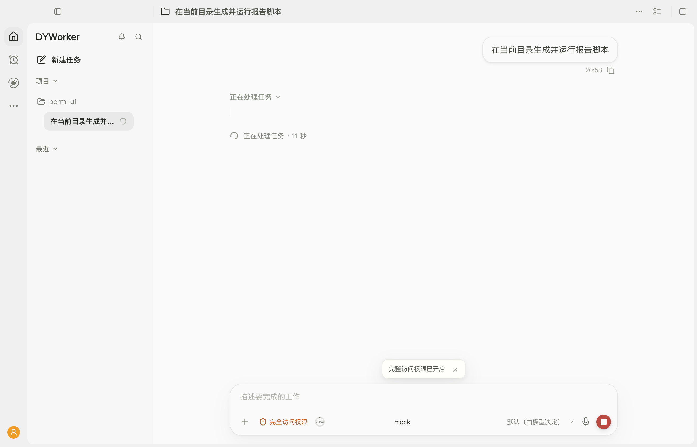

# 微信、QQ 与运行中权限切换调查

## 第二轮：高频微信用户的审批体验（2026-10-12 补充）

用户反馈的是真实使用中的高频微信渠道用户"动不动就要审批"，不是本机任务，因此改用真实渠道入口做
场景复现来定位（模拟模型、模拟消息发送，其余为主进程真实代码：渠道任务入口、审批管线、收件箱、
审核助手接线）。

典型场景：微信用户发一张截图说"把里面的数据整理成 Excel 发我"。任务实际动作是
OCR 识别截图 → 导出 Excel → 跑一段内联 Python 校验 → 跑本地脚本 → 把文件发回聊天。

| 渠道审批档位 | 弹给用户的审批 | 任务结果 |
| --- | --- | --- |
| 替我审批（默认档，审核助手正常） | 0 次 | 跑完并送达 |
| 完全访问 | 0 次 | 跑完并送达 |
| 请示批准 | 3 次（OCR、内联 Python、运行本地脚本） | 跑完并送达（每次都要人答） |
| 替我审批，审核助手中断（模型限额/请求失败） | 2 次 | 每次中断都转人工 |
| 替我审批，审核助手判不定 | 2 次 | 转人工 |
| DSH 渠道 + 替我审批 | 0 次 | 跑完并送达 |

结论：**默认档（替我把关）在高频 IM 使用下本来就不该频繁弹审批**，两种情形会让它变成"动不动就要审批"：
一是把档位设成"请示批准"，二是"替我审批"的审核助手不可用或判不定（每次都转人工）。完全访问与替我审批
在复现里都需要 0 次人工确认。

在此基础上修掉两个让体感更差、也确实存在的缺陷：

1. **用户答复没被认出来，会话被卡住**。待审批期间该会话的其它消息都会被回一句
   "请先回复 1（允许）或 0（拒绝）处理上面的审批"，而审批答复此前只认
   `允许/同意/确认/执行/批准/1/y/yes/ok`。微信、QQ 用户更常回"好的""可以""行""嗯""收到"，
   一句没被认出来就等于被反复要求审批。现在这些常见整句答复都算允许，"不行/不要/否"算拒绝；
   带保留（"好吧"）或带具体内容的长句仍要求明确回答，避免误批。
2. **秒回的答复会被丢掉**。"创建挂起条目"的落盘在队列里排队，"决议"却直接读盘，条目还没写进去
   就被判定"该事项已处理或已失效"，用户答了一次没有下文，只能再答一次。现在决议会等排队中的
   落盘走完再判定。
3. 审批因为权限调宽被撤回时，渠道里会说一句"审批权限已更新，这次操作不用再确认了，任务继续。"
   避免用户继续去回一张已经作废的卡片。

## 结论与证据

本次检查基于当前源码、本机审批记录和实际运行，不把历史安装版本的行为当成当前源码的行为。

1. 微信、QQ 的入口读取的是全局 `settings.approvalMode`（2026-09-02「统一渠道权限」之后即如此），不是渠道自己的旧设置。`settings.channels.approvalMode` 目前只剩兼容迁移用途，不参与判定。
2. 确认的缺陷是**运行中的任务保留启动时的权限**：用户中途切换全局审批模式，桌面、微信、QQ、定时任务和唤醒续跑都没有收到更新；已经弹出的审批也不会按新模式重新判断。这正是"界面已选完全访问、当前任务却仍在等审批"的来源。
3. `Workspace` 已把系统临时目录及其真实路径视为可信临时路径，写入 `/tmp` 不会触发"工作区外"审批；但任务指引缺少生成脚本与交付文件的默认位置，模型容易把要保留的文件写进系统临时目录。
4. 完全访问并非万能：用户规则、工作区规则、敏感凭据路径保护、本机界面类操作的系统级安装确认都优先于完全访问。运行脚本也不等于只读，不能仅凭 `.py` 后缀永久放行所有脚本。
5. "替我审批"下普通 `python3 report.py` 属于低风险，本来就直接放行；只有"请示批准"（逐次确认）才逐条询问。内联代码（`python3 -c`）、外部路径、破坏性命令与数据外发仍会进审核或人工确认。DSH 插件工具按插件风险判定，不按本地脚本放行。
6. 本机审批记录（`~/Library/Application Support/DYWorker/audit.jsonl`，11494 条）中 `full-access` 记录 5135 条且多为自动放行，说明完全访问在正常路径上有效；最近窗口（10-10 至 10-11）只有"工作区外文档编辑"和"对外发布公众号"两次人工确认。记录里没有 IM 渠道任务的条目，因此本次没有把日志当作 IM 反复弹审批的直接证据。

## 本次修改

- 设置成功保存且权限确实变化后，通知正在运行的任务。桌面任务、子任务续跑、微信、QQ、定时任务与唤醒续跑共用同一套订阅（`host/services/settings.mts` 的 `onApprovalModeChange` + `electron/active-permissions.mts`）；明确只读（`deny-changes`）的任务保持只读，不被全局设置放宽。
- 每次工具调用都读取当前权限。已经等待人工审批时按新模式重新判断：允许则继续（按自动放行记录，不算用户批准），拒绝则停止该操作，仍需人工确认则继续等待。
- 自动放行与用户亲自批准保持区分；撤回时同步撤掉桌面审批卡、IM 聊天登记与收件箱等待，避免残留审批卡或把后续聊天内容误当成旧审批答复。入口若不接撤回信号，等待会一直挂着，因此四个入口（桌面 `agent:send`、`agent:continue-child`、渠道、定时/唤醒）都收下撤回信号。
- 完全访问临时放行的外部路径不再变成本轮永久许可，避免切回受限模式后沿用宽松授权；用户亲自批准的路径仍在本轮有效。
- 自动审核（reviewer）返回时若权限已经变化，重新判断，不再沿用旧模式的结果。
- 两种执行方式（普通 `runAgent` 与 DSH）都加入文件位置约定：任务脚本与交付文件默认放当前工作目录，中间文件放当前工作目录下的 `.dyworker/tmp/` 任务专属子目录；用户指定或工具必需的系统临时目录不受影响。这是模型工作指引，不是对工具文件路径的强制重写。

## 验证方式与范围

- `tests/active-permissions.test.mjs`：真实创建并执行 Python 脚本，读取生成文件核对内容；覆盖等待时切换到完全访问（审批撤回）、后续操作免打扰、重新收紧后再请示、钩子强制确认、`deny-changes` 任务不被放宽、DSH 审批等待与取消。结果：6 条通过。
- `tests/dsh-channel-wake-runtime.test.mjs`：调用微信、QQ 真实主进程任务入口（模拟模型与消息发送）。执行新建 Python 脚本，确认首次审批在切到完全访问后撤回、后续执行免审批、结果文件真实落盘、收件箱无遗留等待、任务结束后设置监听已释放。结果：9 条通过（含微信、QQ 各一条）。
- 界面验收（真实浏览器 + 本地前端服务，模拟主进程桥接）：发送任务后出现"运行本地 Python 报告脚本"审批卡；在权限菜单选择「完全访问权限」并确认后，界面切到完全访问，卡片随即消失（卡片计数 1 → 0），无页面报错。

  

  说明：截图里模型与主进程桥接都是夹具，只用来验收界面行为；不是真实模型任务的记录。
- 全量 `npm test`：1561 条中 1515 通过、22 失败 + 1 取消，全部为环境限制，与本改动无关：
  - 18 条 `listen EPERM: operation not permitted 127.0.0.1`（telemetry-client、remote-messages、mcp-extensions、model-recovery）——当前沙箱不允许监听回环端口；
  - 4 条 `sandbox-exec: sandbox_apply: Operation not permitted`（dsh-ptc、dsh-full-session）——当前沙箱不允许 `sandbox-exec`；
  - 1 条 15 秒超时（dsh-app-runtime:179）——等待的官方工作流子任务因同一 `sandbox-exec` 限制无法启动。
- 全量那一次的采集时间早于第二轮改动，第二轮改动本身由上面的分组用例覆盖（重启全量跑时两次卡在
  `agent.test.mjs` 中途——该文件正被同一个工作区里的另一项任务并行修改，单独跑 254 条全过、12 秒完成，
  两次卡住都发生在本机同时跑其它 node 进程时，按环境/并发干扰处理，未作为本改动的结论）。
- 前后端类型检查：`tsc -p tsconfig.electron.json --noEmit` 与 `tsc --noEmit` 均通过。
- 第二轮补充验证：`tests/channels.test.mjs`（审批答复识别，含"好的/可以/行/收到"与"不行/不要/否"）、
  `tests/inbox.test.mjs`（秒回决议不丢、不留钉子户）、`tests/dsh-channel-wake-runtime.test.mjs`
  （撤回审批时 IM 收到告知）共 84 条通过；`tests/host.test.mjs`、`tests/desktop-contract.test.mjs`、
  `tests/settings.test.mjs`、`tests/wake-scheduler.test.mjs`、`tests/security-approval.test.mjs`
  共 138 条通过；前后端类型检查通过。

未改动用户实际设置，未向真实微信或 QQ 发送消息，未重新打包或替换已安装应用；本次修改仍是工作区里的未提交改动，需要通过构建/安装才会进入实际使用的应用。已经开始执行的命令不会因之后收紧权限而自动中断，新权限用于尚未执行的后续操作。系统自身的文件、辅助功能、屏幕录制授权不属于本次修正范围。
