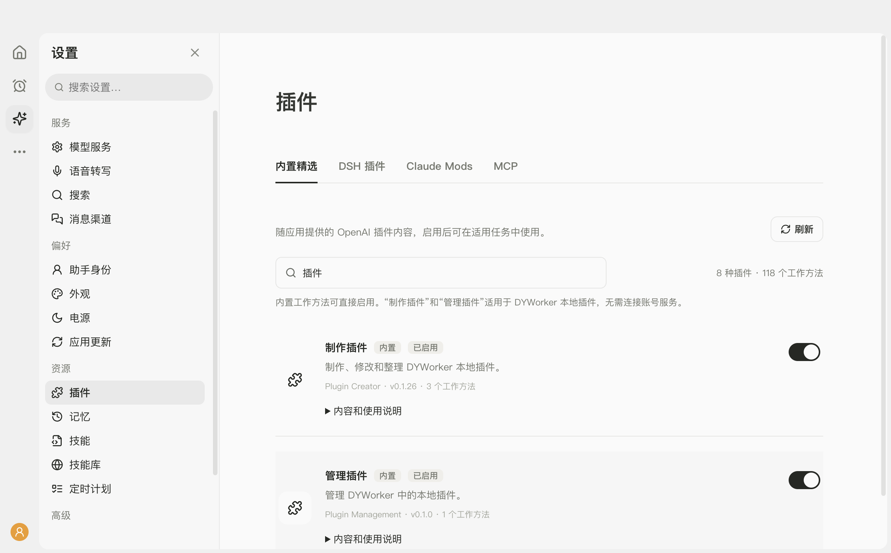

# OpenAI 精选插件内置说明

当前保留 8 种插件，共 118 个工作方法；均可本地启用。正常启动和打包不依赖本机的 Codex 缓存。入口：插件 → 内置精选。

| 名称 | 原插件名称 | 来源版本 | 工作方法数 | 当前范围 |
| --- | --- | --- | ---: | --- |
| 数据分析 | data-analytics | 1.0.11 | 20 | 本地工作方法已接入 |
| 投行业务 | investment-banking | 0.1.29 | 23 | 本地工作方法已接入 |
| 办公模板 | openai-templates | 0.1.1 | 20 | 本地工作方法已接入 |
| 制作插件 | plugin-creator | 0.1.26 | 3 | 已改为 DYWorker 本地工作方法 |
| 管理插件 | plugin-management | 0.1.0 | 1 | 已改为 DYWorker 本地工作方法 |
| 产品设计 | product-design | 0.1.56 | 10 | 本地工作方法已接入 |
| 股票研究 | public-equity-investing | 0.1.31 | 23 | 本地工作方法已接入 |
| 销售工作 | sales | 1.1.0-alpha.2 | 18 | 本地工作方法已接入 |

## 使用范围

“制作插件”用于制作、修改、检查和整理 DYWorker 本地插件，复用应用已有的本地制作要求。“管理插件”用于查看与管理 DYWorker 的插件；通过当前真实提供的管理能力执行，没有应用控制能力时给出对应界面步骤，并说明尚未执行的部分。两个插件均不要求连接 OpenAI 账号服务，也不声称具有账号插件的在线创建、提交或管理能力。

“网站发布”“Slack”“动态宠物”已从随应用提供的文件和清单移除；后续重新导入缓存时也排除这三种插件。旧启用设置不能使它们重新出现在列表中。

其他插件保留原始工作方法、脚本和模板。部分工作方法要求的在线数据、图像生成或发布服务仍以应用实际提供的工具为准；内置资料不等于已连接原插件声明的服务。

保留其余插件的原始资料、作者和许可；制作和管理插件的实际执行内容由 DYWorker 本地改编说明提供，来源文件保持原样。相同名称的金融工作方法通过原插件名前缀区分。插件总开关优先于单个工作方法开关；启停设置保留到重启之后。应用只读访问随应用提供的资料，生成内容写入当前工作文件夹。

## 本次验证

- 13 项相关检查通过：核对全部文件与锁定内容，读取 118 个工作方法，验证启停与重启恢复，确认已移除插件不会被旧设置或旧清单恢复。
- 加载制作、修改、交付整理和管理方法，确认实际执行内容适用于 DYWorker 本地插件，不再使用来源中的账号服务要求。
- 制作指南中的样例通过真实导入、注册与调用；代表性输入和异常输入均验证。制作出的本地插件通过实际宿主安装并验证启停。
- 实际桌面显示 8 种插件、118 个工作方法；两个插件无连接服务提示，开关可操作，展开说明排版正常，无横向溢出。
- 逐一搜索网站发布、Slack、动态宠物，页面均显示没有匹配项。
- 实际关闭并重启桌面测试窗口，两个插件保持停用，四个工作方法全部停用；通过开关重新启用后四个工作方法恢复。
- 测试使用独立临时资料，未替换已安装应用。最终独立副本的完整检查通过：1524 项检查中 1501 项通过、23 项跳过、0 项失败；页面和桌面构建均成功。

## 验证范围

验证副本固定本次改动，并排除任务期间另一个会话新增的 BotTeam 接入：context.mts 保持本次任务开始时的版本，未包含 ds-bot 插件目录与 bot-team.mts 服务文件。本次涉及的六份程序、清单和检查文件已逐一确认与原工作区相同，保留插件的全部来源文件通过内容校验。原工作区仍同时进行其他功能修改，不能将独立副本通过视为这些其他改动也已通过。

## 维护

项目内容位于 builtin-plugins/curated；snapshot.json 锁定来源版本和文件内容。本地改编说明位于 electron/curated-plugin-guides.ts。scripts/import-curated-plugins.mjs 仅在明确更新内置内容时运行，普通构建不读取外部缓存。内置不改变原插件的许可。
